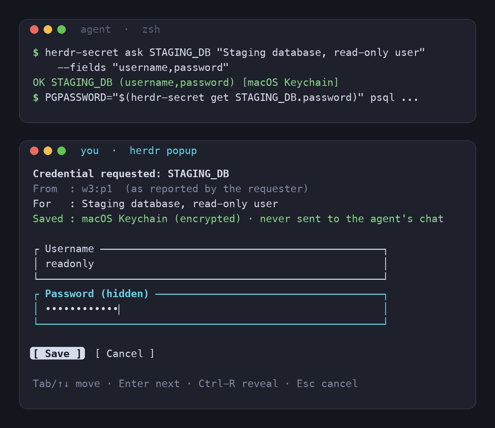

# herdr-secret

[](https://www.npmjs.com/package/herdr-secret)
[](https://github.com/mazemaker/herdr-secret/actions/workflows/test.yml)
[](LICENSE)

A plugin for the [herdr](https://herdr.dev) terminal app (the TUI), with a mod for Herdr.app,
that lets a coding agent ask you for a credential without the value ever entering the agent's
conversation.

The agent runs one command. A form pops up in your herdr session, you type the values there,
and they go straight into your operating system's credential store. The agent only gets back
`OK`, `CANCELLED`, `TIMEOUT` or `FAILED`.

The form is a herdr popup, not a desktop window, so it shows up wherever you are attached:
at the machine, over SSH, or from a phone.



> **Herdr.app too.** In Herdr.app, the desktop app, the same `herdr-secret ask` opens a dialog
> in the Herdr window instead of a TUI popup, through the herdr-secret mod that ships in this
> repository. See [Herdr.app](#herdrapp).

## Install

```sh
npx herdr-secret@latest
```

The same command works on macOS, Linux and Windows.

With the herdr TUI, the installer adds the plugin to herdr (herdr shows you what it will run and
asks first). With only Herdr.app, it runs from the npm package and copies herdr-secret to
`~/.local/share/herdr-secret/engine` instead. With both, it does the first and adds the
Herdr.app mod. Then it walks you through setup:

1. **Requirements.** Checks Python, and herdr or Herdr.app (one of them is enough).
2. **Credential store.** Saves and deletes a test value to make sure the store works. On Linux
   without a Secret Service it offers to install `secret-tool`, and tells you before falling
   back to unencrypted files.
3. **The `herdr-secret` command.** Links it into `~/.local/bin` and, if that is not on your
   PATH, offers to add it to your shell profile. On Windows it offers to add the plugin folder
   to your user PATH.
4. **Herdr.app mod.** If Herdr.app is installed, copies the mod into
   `~/.config/herdr-app/mods/herdr-secret` (asks first) and has Herdr.app check it.
5. **Your agents.** Finds Claude Code, Codex, OpenCode and Gemini CLI, shows which files it would
   change, and asks before adding instructions (and, for Claude Code, a skill) that tell them to
   ask through herdr-secret instead of asking you to paste credentials.
6. **Try it.** Opens the form once, in the terminal, with a test value and deletes it afterwards.

Everything it adds sits between `herdr-secret:begin` and `herdr-secret:end` markers.
`herdr-secret uninstall` (or `npx herdr-secret uninstall`) removes all of it, including the
Herdr.app mod, asks whether to delete stored credentials, and can remove the plugin from herdr.

If you install with plain `herdr plugin install mazemaker/herdr-secret`, setup opens by itself
the next time herdr starts, or open it any time with
`herdr plugin action invoke mazemaker.secret.setup` (`setup-windows` on Windows).

Requirements:

- the herdr TUI, 0.9.5 or newer, or Herdr.app, or both
- Python 3.8 or newer, which the plugin runs on. Only the standard library is used.
- Node.js 18 or newer, only for the `npx` installer.
  - macOS and Linux: `python3` on the PATH herdr runs with.
  - Windows: the `py` launcher from the python.org installer, or `python` on PATH.

## Use

From an agent, or any shell inside herdr or Herdr.app:

```sh
herdr-secret ask DB_LOGIN "Staging database, read-only user" --fields "username,password"
# OK DB_LOGIN (username,password) [macOS Keychain]

herdr-secret ask API_TOKEN "Deploy token"            # one hidden field, stored as API_TOKEN
herdr-secret get DB_LOGIN.password | psql ...        # refuses to print to a terminal
herdr-secret list                                     # names only
herdr-secret rm DB_LOGIN                              # removes DB_LOGIN and DB_LOGIN.<field>
```

- With `--fields`, each value is stored as `NAME.<field>`. Without it, one hidden value is
  stored as `NAME`.
- Fields named `user`, `username`, `email`, `login`, `host` or `url` are shown as you type.
  Every other field is masked. Override with `name:plain` or `name:hidden`. Up to 6 fields,
  1000 characters each.
- `--timeout` sets how long to wait, in seconds. The default is 300. When it runs out the form
  closes itself and nothing is saved.
- If a name already holds a value, the form says it will be replaced before you save.
- A multi-field save is all or nothing: if one field fails, the others are put back.

In the form: Tab or the arrow keys move between fields. Enter moves to the next field and
saves from the last one. Ctrl-R reveals the focused field, Ctrl-U clears it, and Esc or
Ctrl-C cancels.

### Telling your agent about it

Setup does this for the agents it finds. For any other agent, add the contents of
[`agents/instructions.md`](agents/instructions.md) to its instructions file.

## Herdr.app

Herdr.app, herdr's desktop app, runs its terminals in herdr-core, which has no plugin popups.
Herdr.app is extended with **mods** instead, and this repository ships one:
[`mods/herdr-secret`](mods/herdr-secret). Agents run the same `herdr-secret ask`; in a Herdr.app
terminal it opens the mod as a dialog in the Herdr window.

The dialog has the same parts as the form:

- the name being asked for, the terminal that asked and what it is for (both as reported by
  the agent), and where the value will be saved
- one field per value; masked fields have a Show/Hide button
- a note when a name already holds a value, and Save and Cancel

Tab moves between fields, Enter moves on and saves from the last one, and Esc cancels. While a
request waits, Herdr plays its "needs you" sound and badges the Dock icon (macOS). The dialog
closes itself when the timeout runs out, and a toast confirms a save.

`npx herdr-secret@latest` installs it, with or without the herdr TUI (see [Install](#install)).
Without the mod, `herdr-secret ask` in a Herdr.app terminal stops at once and says how to install
it.

How a value gets from the dialog to the store: mods can start programs only with arguments,
which other processes can list. So `ask` writes the request, with a one-time pad, to
`~/.local/state/herdr-secret/app-request.json` (a folder only you can read). The dialog XORs each
value with its own slice of the pad, passes it to `herdr-secret app-store` as hex, and the engine
deletes the request, pad included, as soon as it is answered. A pad never covers two values.

## Where values are stored

- **macOS:** the login Keychain, service `herdr-secret`.
- **Windows:** Credential Manager, as generic credentials named `herdr-secret:<NAME>`.
- **Linux:** the Secret Service (GNOME Keyring, KWallet) through `secret-tool`.
  - On a machine without one, such as a headless server, values go to files under
    `~/.local/share/herdr-secret/store/` with mode 0600. These files are **not encrypted**.
    The result line names the store used, so this never happens silently.

Values reach the store over stdin or the OS API, never on a command line. Nothing is written
to logs. The status file the agent reads holds only the outcome and the store's name.

The popup is not a herdr pane: it does not show up in `herdr pane list`, and `herdr pane read`
cannot reach it, so an agent cannot watch what you type. In Herdr.app the dialog is drawn by the
app itself, not in a terminal.

## What this does and doesn't protect

It keeps credentials out of the agent's chat, transcript and logs, and puts them in an
encrypted store instead of a plaintext `.env`.

It does not hide them from programs running as you. An agent that runs `herdr-secret get`
can read what is stored, and so can anything else under your account. An agent that can run
commands could also start the form itself with a tampered environment. Treat all of this the
same way you treat letting an agent run commands at all.

In Herdr.app, a program running as you could also read the request file and the hex arguments
while you save, and so recover the value; that is the same exposure as the stored value itself.

The form shows which herdr pane (or Herdr.app terminal) asked and the agent's description of what the value is for.
Both come from the agent, so the "From" line is marked as reported, not verified. Read both
before typing: an agent can be talked into asking for something it shouldn't have.

## Development

```sh
herdr plugin link .                 # use a local checkout
python3 -I tests/test_store.py      # round-trips awkward values through this OS's store
python3 -I tests/test_form_pty.py   # drives the form in a pseudo-terminal (macOS, Linux)
python3 -I tests/test_setup.py      # setup and uninstall in throwaway homes: TUI, Herdr.app, both
python3 -I tests/test_app.py        # the Herdr.app request, app-store/app-cancel and ask routing
(cd npm && npm test)                # the npm bootstrap
herdr-app check mods/herdr-secret   # loads the Herdr.app mod once (renders a sample form)
```

CI runs these on macOS, on Linux with and without a Secret Service, and on Windows.

## Security

See [SECURITY.md](SECURITY.md) for how to report a problem and how releases are published.

## License

MIT
