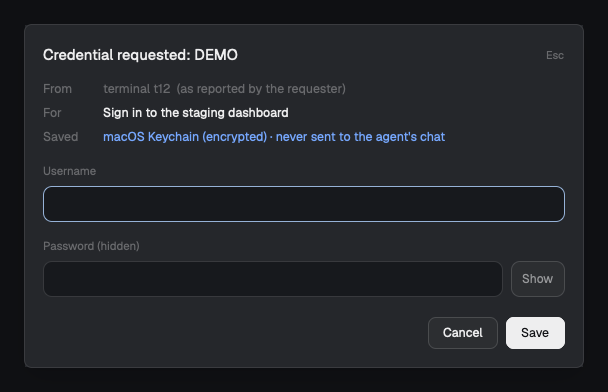

# herdr-secret

A dialog in the Herdr window where you type a credential an agent asked for. The agent runs
`herdr-secret ask NAME "what it is for"` in a Herdr.app terminal; the dialog shows who asked,
what for and where the value will be saved, you fill in the fields, and the value goes straight
into the OS credential store. The agent only learns `OK`, `CANCELLED`, `TIMEOUT` or `FAILED`.

> **Before adding:** this mod **runs a program** and **reads a file outside its folder**. It
> reads `~/.local/state/herdr-secret/app-request.json`, written by the herdr-secret engine, and
> runs the Python interpreter and engine script named in that file
> (`<python> -I <script> app-store|app-cancel ...`). It needs that engine installed
> (`npx herdr-secret@latest`, which also installs this mod) and does nothing on its own. It makes
> no network requests.

## What you see

One dialog, 560 px wide, theme `popover` background, 18 px padding, opened over the window.

- **Header row:** `Credential requested: NAME` (15 px, semibold) on the left, `Esc` (11 px,
  `dim`) on the right.
- **Three lines** (12.5 px, 4 px apart, 8 px below the header), each a 52 px key column in
  `dim` and the value:
  - `From`: `terminal t3  (as reported by the requester)`, in `dim`
  - `For`: the agent's description, or `(no description given)`
  - `Saved`: where the value goes, e.g. `macOS Keychain (encrypted) · never sent to the agent's
    chat`; in `done` when the store encrypts, in `blocked` when it does not (Linux 0600 files)
- **Replaces** (only when a name already holds a value): `Replaces the stored value of:
  NAME.password`, 12 px, `blocked`, 8 px above.
- **One block per field:** the label (11.5 px, `dim`, 14 px above, 6 px below), with
  ` (hidden)` after masked ones; then a 36 px input, 10 px side padding, 9 px radius, 1 px
  border (`accent` when focused, `input` otherwise), `background` fill, 12.8 px text. A masked
  field has a `Show`/`Hide` button beside it: 36 px high, 10 px padding, 9 px radius, `raised`
  fill, `input` border, 12 px `muted` text, 8 px gap.
- **Error line** (when there is one): 12 px, `ansi1`, 10 px above.
- **Footer:** right-aligned, 20 px above, 8 px apart: `Cancel` (`raised` fill, `input` border,
  `foreground` text) and `Save` (`solid` fill and border, `solid_foreground` text); both 32 px
  high, 14 px padding, 8 px radius, 12.5 px medium.

Other states, same frame:

- **Loading:** `Loading the request…` in `dim`, for the moment it takes to read the file.
- **Saving:** the form, with the Save button reading `Saving…`.
- **Not saved:** `Not saved: NAME` (15 px semibold), the reason in `ansi1`, `The agent was
  told that it failed.` in `dim`, and a `Close` button.
- **Nothing waiting:** `No credential request is waiting` and `Agents open this dialog with
  herdr-secret ask.` with a `Close` button; it closes itself after 4 seconds.

## How it behaves

- It does not show agent statuses. While a request waits, Herdr plays its `blocked` sound once
  and the Dock icon shows `1` (macOS); both clear when the dialog answers.
- The first field has the keyboard. **Tab** and **Shift-Tab** cycle through the fields,
  **Enter** moves to the next field and saves from the last one, **Esc** closes the dialog,
  which cancels.
- **Show/Hide** unmasks or masks its field. Buttons fade to 0.88 opacity on hover.
- **Save** checks that every field is filled, at most `max` characters (counted by code point)
  and free of control characters, and says so in the error line if not. Then it runs the
  engine's `app-store`. On `OK` it clears the fields, posts a toast (`Saved NAME`, `In <store>.
  The agent only learns that you answered.`, level success) and closes. On anything else it
  shows **Not saved**; the request is over either way.
- **Cancel**, Esc or closing the window runs `app-cancel` and closes.
- At the request's deadline the dialog runs `app-cancel REQ TIMEOUT` and closes by itself.

## Built from

- `mods/herdr-secret/mod.json`:
  `{ "place": "none", "title": "Credential request", "overlay": { "kind": "dialog", "width": 560 } }`.
  Not docked anywhere; the engine opens it with `herdr-app do mod.open --name herdr-secret`
  (and `open -a Herdr` on macOS to bring the window forward).
- `mods/herdr-secret/main.js`: one `View`. `gpui-kit`: `View`, `div`. `gpui-base`: `v_flex`,
  `h_flex`, `InputState` (`set_masked`, `value`, `set_value`, `focus`; `submit`, `change`,
  `focus` events), `Input`. `herdr`: `exec`, `home`, `readTextFile`, `props`, `closeOverlay`,
  `theme`, `playSound`, `setBadge`, `notify`, `checking`. Timers with `cx.timer.after` only.
- **The request** (`home() + "/.local/state/herdr-secret/app-request.json"`, JSON): `req` (id),
  `name`, `purpose`, `from`, `fields` (`[{name, label, hidden}]`), `store`, `encrypted`,
  `replaces` (names), `deadline` (Unix seconds), `max` (characters), `pad` (hex, 4096 bytes per
  field), `python`, `script`.
- **Programs it runs**, both from the request: `<python> -I <script> app-store <req> <hex>...`
  (one argument per field, in field order) and `<python> -I <script> app-cancel <req> [TIMEOUT]`.
  `app-store` prints `OK <store>` or `FAILED <reason>`.
- **The encoding:** a value's UTF-8 bytes, byte `i` of field `f` XORed with pad byte
  `f * 4096 + i`, as lowercase hex. Programs can be given data only as arguments, which other
  processes can list; the pad keeps the value itself out of them.
- No art.

## Watch out

- The folder must be named `herdr-secret`: the engine opens `mod.open --name herdr-secret` and
  checks for `mods/herdr-secret/main.js` under `$HERDR_APP_HOME` or `~/.config/herdr-app`.
  Without it, `ask` fails at once and says how to install the mod.
- `mod.open` toggles. A dialog still open when the next request arrives would be closed instead
  of opened, so never leave it open after an answer: close as soon as a save succeeds (the
  toast confirms it, not a "Saved" screen), and let the empty state close itself. The engine
  also waits a second between one dialog closing and the next opening.
- Every `app-store` call ends the request, whatever it answers, so a pad is never used twice. Do
  not offer a retry in the same dialog; show **Not saved**.
- `init` runs for real under `herdr-app check`. With `checking()` true, render a sample request
  and read or run nothing; otherwise a check could read a real pending request.
- The request path is fixed under `home()`; the mod cannot see `XDG_STATE_HOME`.
- The request names the program to run. It lives in a 0700 folder, so anything that can change
  it already runs as you.
- Install as real files, not a symlink.
- Limits: up to 6 fields, 1000 characters per value, a 300-second deadline unless the agent
  passes `--timeout`.

## Done when

- `herdr-app check mods/herdr-secret` passes (it renders the sample form).
- In a Herdr.app terminal, `herdr-secret ask DEMO "a test" --fields "username,password"` opens
  the dialog: `From terminal tN`, `For a test`, a `Saved` line, Username shown, Password masked
  with a Show button. The Dock badge reads 1.
- Save stores both values: the terminal prints `OK DEMO (username,password) [<store>]`,
  `herdr-secret list` shows `DEMO.password` and `DEMO.username`, a toast reads `Saved DEMO`, and
  `~/.local/state/herdr-secret/app-request.json` is gone.
- A second `ask` right after a save opens a fresh dialog.
- Esc prints `CANCELLED DEMO (username,password)`; with `--timeout 10` and no answer, the dialog
  closes itself and the terminal prints `TIMEOUT DEMO (username,password)`.
- `herdr-secret rm DEMO` removes the test values.
