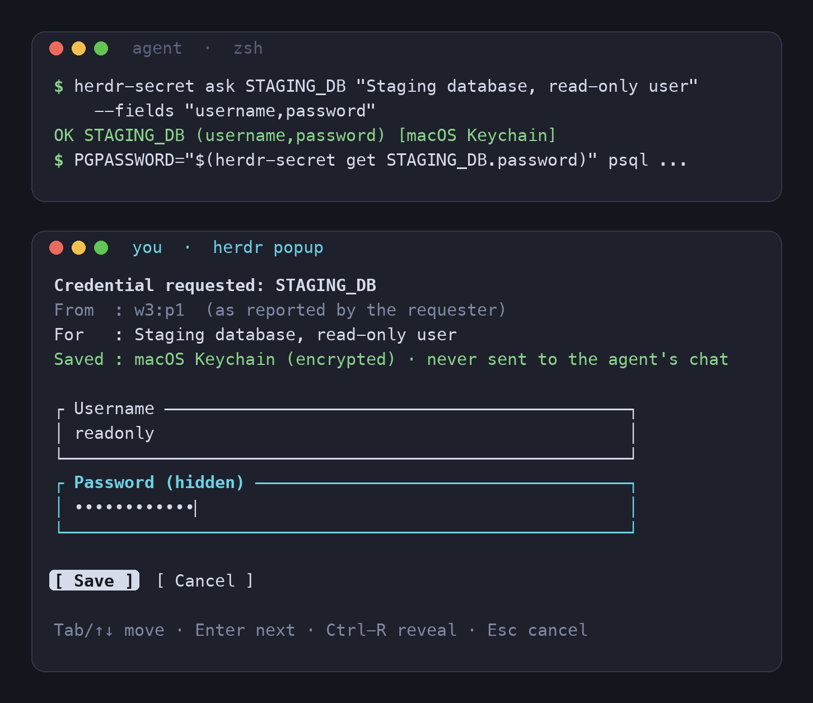

# herdr-secret

[](https://www.npmjs.com/package/herdr-secret)
[](https://github.com/mazemaker/herdr-secret/actions/workflows/test.yml)
[](https://github.com/mazemaker/herdr-secret/blob/main/LICENSE)

Let your coding agents ask you for credentials without the value ever entering their chat.

An agent runs `herdr-secret ask`. A form pops up in your [herdr](https://herdr.dev) session,
you type the value there, and it goes straight into your operating system's credential store.
The agent only gets back whether you answered.



## Install

```sh
npx herdr-secret@latest
```

Works on macOS, Linux and Windows. It installs the herdr plugin from
[GitHub](https://github.com/mazemaker/herdr-secret) (herdr shows what it will run and asks
first), then walks you through setup:

- checks that your credential store works,
- puts the `herdr-secret` command on your PATH,
- offers to teach the agents it finds (Claude Code, Codex, OpenCode, Gemini CLI) to ask
  through it instead of asking you to paste credentials,
- lets you try the form once.

`npx herdr-secret uninstall` removes everything setup added.

## Where values go

- **macOS:** login Keychain
- **Windows:** Credential Manager
- **Linux:** Secret Service (GNOME Keyring, KWallet). Without one, setup asks before falling
  back to 0600 files.

Values never pass through a command line or a log, and the popup is not a herdr pane, so an
agent cannot read it.

## Trust

- No dependencies. This package is one small script that finds herdr and Python and hands over
  to the plugin.
- Published from GitHub Actions with npm provenance: the attestation on each version names the
  commit and workflow run that built it.
- [What it protects and what it doesn't](https://github.com/mazemaker/herdr-secret#what-this-does-and-doesnt-protect),
  and [how to report a security problem](https://github.com/mazemaker/herdr-secret/blob/main/SECURITY.md).

Requires herdr 0.9.5+, Python 3.8+ (the plugin runs on it), and Node 18+ for this installer.
MIT licensed.
